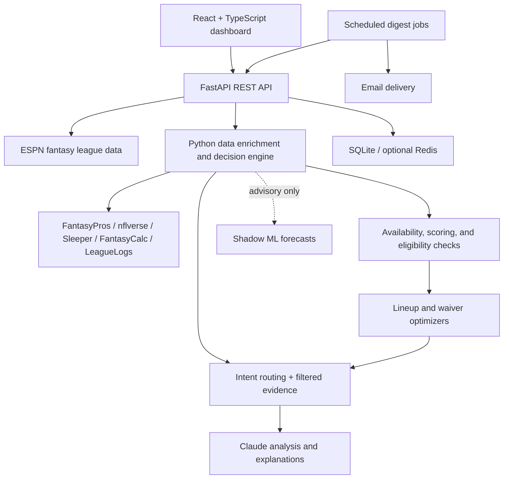

# Fantasy Coach

**A full-stack, AI-powered fantasy football advisor built around real league data, explainable recommendations, and measurable decision quality.**

Fantasy Coach connects to an ESPN fantasy football league to analyze rosters, compare players, optimize starting lineups, evaluate waiver-wire moves, monitor injuries, and explain weekly matchups. It combines deterministic Python decision-making with Claude-powered analysis, while keeping factual checks and roster eligibility outside the language model.

The project also includes an experimental machine-learning forecasting pipeline, scheduled email digests, and a responsive React dashboard. It is a **personal engineering project**, not an official ESPN or FantasyPros product.

## Features

### Fantasy analysis and decision support

- **AI Coach:** Ask natural-language start/sit, waiver, player-comparison, and rest-of-season questions using league-aware context.
- **Optimal lineup:** Select eligible starters for QB, RB, WR, TE, FLEX, D/ST, and K using available projections, with explanations for recommended players.
- **Waiver advisor:** Evaluate add/drop combinations, projected lineup effects, roster depth, and short-term versus rest-of-season value.
- **Player profiles:** View projections, game logs, recent usage, injury information, matchup context, and on-demand AI analysis.
- **Matchup and opponent intelligence:** Explore current and historical matchups, opposing rosters, standings, league schedules, and player-by-player comparisons.
- **News and NFL statistics:** Browse fantasy-relevant news, roster-specific updates, and verified NFL statistical leaderboards.

### Automation and reporting

- **Email digests:** Opt-in lineup recommendations, bye-week alerts, injury updates, and post-week recaps, with confirmation and unsubscribe flows.
- **Weekly recaps:** Generate AI-written summaries only after the relevant NFL games and ESPN fantasy scores are final.
- **Guarded ESPN lineup actions:** Preview changes before submitting them, with opt-in write permissions, confirmation tokens, kickoff/lock checks, and post-submission verification where supported.
- **Auto Swap (experimental):** An opt-in mechanism for checking unavailable starters. **Live automatic substitutions have not been conclusively validated and should not be relied upon unattended.**
- **Analysis caching:** Reuse player reports during the same fantasy week; supports local SQLite and optional persistent Upstash Redis storage.

## Technology stack

| Layer | Technologies |
| --- | --- |
| Frontend | React, TypeScript, Vite, Lucide React |
| Backend | Python 3.12, FastAPI, Uvicorn, Pydantic |
| AI | Anthropic Claude API, intent-aware prefetching and compact prompt context |
| Data engineering | Pandas, Polars, nflreadpy, Parquet, provider-specific caching |
| Machine learning | scikit-learn, histogram-based gradient boosting, joblib |
| Storage | SQLite; optional Upstash Redis for persistent analysis caching |
| Automation | GitHub Actions, scheduled Python jobs, Resend or SMTP |
| Deployment | Render, Docker; Capacitor configuration for an experimental iOS wrapper |

## Architecture



### Why this architecture?

The application separates **authoritative facts** from **advisory judgments**:

1. **ESPN and verified NFL data** determine roster ownership, available players, scoring settings, byes, injuries, game status, and other factual constraints.
2. **Deterministic Python algorithms** normalize player identities across providers, evaluate eligibility, compute comparisons, and optimize lineup and waiver choices.
3. **Compact, query-specific evidence** is assembled for Claude. Player pools are filtered before generation rather than sending every free agent or stat field to the model.
4. **Claude** provides contextual recommendations and natural-language explanations, but cannot override hard eligibility constraints.
5. **Shadow ML forecasts** are available for comparison and auditing; **they do not control live lineup decisions**.

This design prioritizes accuracy, observability, and **useful decisions per LLM token** over indiscriminately sending large datasets to an AI model.

## Data sources

| Source | Role in the system |
| --- | --- |
| **ESPN Fantasy** | League settings, current roster, free agents, scoring, projections, matchups, and lineup slots |
| **FantasyPros** | Expert consensus rankings, projections, and injury/practice context when available |
| **nflverse** | Historical and current-season player performance, game schedules, usage, and model-training data |
| **Sleeper** | Supplemental player metadata, injury, and depth-chart context |
| **FantasyCalc** | Trade-market-derived player value signals, not weekly point projections |
| **LeagueLogs** | Additional redraft and rest-of-season market signals |

Provider-specific TTL caches, rate-limit handling, and fallbacks reduce redundant requests. Missing or unverifiable fields are flagged rather than silently invented. League-specific reception scoring is derived from ESPN settings instead of assuming every league uses full PPR.

## Machine learning and evaluation

The experimental forecasting system uses historical **2021–2026** player-week data and FantasyPros expert consensus features to train scikit-learn gradient-boosting models.

- **Feature engineering:** Recent fantasy points, passing/rushing/receiving volume, target share, air-yards share, position, and historical expert rankings.
- **Leakage prevention:** Weekly predictions use information available before the target game week; rolling training updates exclude current or unfinished-week outcomes.
- **Backtesting:** Compare forecasts with historical outcomes using MAE/RMSE and decision-oriented analyses, including lineup regret and player-ranking comparisons.
- **Shadow deployment:** Produce and log forecasts alongside ESPN and FantasyPros projections without allowing the experimental model to override the deterministic optimizer.
- **Recommendation auditing:** Save pregame decision snapshots and explicit AI-choice receipts for later evaluation against actual results, avoiding hindsight contamination.

The ML pipeline is an **evaluation and research component**, not a claim that it currently outperforms established projections.

## Getting started

### Prerequisites

- Python 3.12 and [`uv`](https://docs.astral.sh/uv/)
- Node.js and npm
- Access to an ESPN fantasy football league
- Anthropic API credentials for AI features
- Optional FantasyPros credentials for provider-specific enrichment

> **Security:** This project is configured for a personal ESPN league. Never commit `.env` files, ESPN session cookies, API keys, email credentials, or cloud access tokens. Some ESPN lineup-write functionality uses an undocumented private endpoint and should be treated as experimental.

### 1. Install dependencies

From the repository root:

```bash
uv sync
cd web
npm install
cd ..
```

### 2. Configure environment variables

Create a local `.env` file in the repository root and supply your own credentials:

```dotenv
# ESPN league connection
ESPN_LEAGUE_ID=your_league_id
ESPN_TEAM_ID=your_team_id
ESPN_S2=your_private_espn_s2_cookie
ESPN_SWID=your_private_espn_swid_cookie

# AI and optional premium provider data
ANTHROPIC_API_KEY=your_anthropic_api_key
FANTASYPROS_API_KEY=your_fantasypros_api_key

# Keep ESPN roster modifications disabled by default
ESPN_WRITES_ENABLED=0
ESPN_AUTO_SWAPS_ENABLED=0
```

The optional email, Redis, remote-access, and cloud settings are configured separately. Keep production credentials in the hosting provider's secret/environment-variable settings rather than source control.

### 3. Start the FastAPI backend

From the repository root:

```bash
uv run uvicorn api:app --app-dir app --host 127.0.0.1 --port 8000
```

### 4. Start the React frontend

In another terminal:

```bash
cd web
npm run dev
```

Open **http://127.0.0.1:5173**. The Vite development server proxies `/api` requests to the backend on port `8000`.

### Optional: Run the command-line AI coach

```bash
uv run python app/llm.py
```

The CLI supports conversational questions and a `refresh` command to reload the latest league data.

## Automated jobs

The digest worker is a **run-once command**, intended to be invoked by GitHub Actions or another scheduler:

```bash
uv run python app/run_digest_jobs.py
```

It checks which events are due, sends only to confirmed subscribers, and records delivery events to avoid duplicate emails. Email delivery can use Resend or SMTP when configured. Running the FastAPI server by itself does **not** start a background scheduler.

The repository's deployment setup uses Render for the web/API service and GitHub Actions for scheduled checks. Persistent state and credentials require separate cloud configuration.

## Project structure

```text
fantasy_football/
├── app/
│   ├── api.py                    # FastAPI routes and sessions
│   ├── llm.py                    # Claude orchestration and intent routing
│   ├── espn_client.py            # ESPN league and roster integration
│   ├── player_enrichment.py      # Cross-provider player data
│   ├── lineup_optimizer.py       # Legal starting-lineup selection
│   ├── waiver_advisor.py         # Add/drop transaction analysis
│   ├── league_intelligence.py    # Standings, opponents, matchups
│   ├── player_analysis.py        # On-demand AI player reports
│   ├── training_data.py          # Historical feature pipeline
│   ├── train_ecr_model.py        # Gradient-boosting experiments
│   ├── rolling_retrain.py        # Completed-week model updates
│   ├── shadow_predictor.py       # Non-decision-making ML forecasts
│   ├── recommendation_journal.py  # Pregame AI decision records
│   ├── weekly_recap.py           # End-of-week summaries
│   ├── email_subscriptions.py    # Subscriber state and delivery
│   └── run_digest_jobs.py        # Scheduler entry point
├── web/
│   ├── src/                      # React / TypeScript application
│   ├── package.json
│   └── vite.config.ts
├── tests/                         # Automated tests
├── .github/workflows/             # Scheduled automation
├── Dockerfile                     # Container deployment
├── pyproject.toml                 # Python dependencies
└── uv.lock
```

## Development and validation

```bash
# Python unit tests
uv run python -m unittest discover -s tests -v

# Frontend type-check and production build
cd web
npm run build
```

The repository is actively evolving. Before enabling writes or automated substitutions, validate against the current ESPN roster, league rules, and game locks.

## Current limitations

- **Auto Swap:** Code and configuration exist, but end-to-end live ESPN automatic swaps have not been conclusively verified.
- **Forecasting:** The historical ML model runs in shadow mode; no demonstrated production accuracy advantage is asserted.
- **External data:** APIs can be unavailable, delayed, rate-limited, or inconsistent. The app reports missing evidence rather than treating it as proof of an outcome.
- **Deployment:** Optional persistent Redis caching, email delivery, and mobile remote access require correctly configured services and credentials.
- **iOS:** Capacitor/iOS project configuration exists; a published native iOS app is not claimed.

## Disclaimer

Fantasy Coach is a personal educational project. It is not affiliated with, sponsored by, or endorsed by ESPN, FantasyPros, the NFL, Anthropic, or the other data providers. Fantasy recommendations are informational, not guarantees of future performance.
